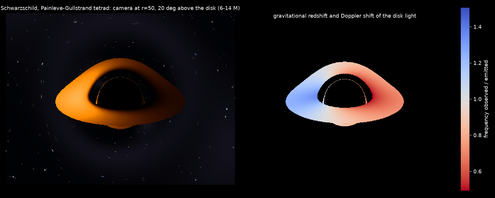

# Gauge Theory Gravity in Conformal Spacetime Algebra

This repository holds a proposal for formulating Gauge Theory Gravity (GTG) in the real conformal spacetime algebra
$\mathrm{Cl}(2,4;\mathbb R)$, and a numerical test-bed that checks it. The proposal is reproduced in full
[below](#the-proposal-conformal-spacetime-algebra-gauge-theory-of-gravity) (also as
[a PDF](Gauge_Theory_Gravity_in_Conformal_Spacetime_Algebra.pdf)).

The test-bed, `src/gauge_theory_gravity`, is written on [numga](https://github.com/EelcoHoogendoorn/numga) extensors with JAX
autodiff. It implements the 15-component bivector connection $\Omega(a,x)$, versor gauge transformations, the covariant
derivative, the curvature and path-ordered transport, and evaluates them on given spacetimes. It does not solve any
field equations: the proposal leaves the dynamics open. The code derives the field equations of chosen actions
pointwise and checks known solutions against them.

## What has been checked

- **Every formula in sections 4–8 holds as written**, including each factor of $\tfrac12$: gauge covariance of
  $\mathcal D_a$, $[\mathcal D_a,\mathcal D_b]\Psi=\tfrac12\mathcal F(a,b)\Psi$, the Bianchi identity, flatness of pure
  gauge, transport as a versor, and holonomy $\approx\exp(-\tfrac12\epsilon^2\mathcal F)$ around small loops.
- **Lorentz sector (9.1):** the Levi-Civita connection of a tetrad, embedded in the Lorentz sector, has curvature equal
  to the Riemann tensor computed independently from Christoffel symbols. A general $\mathrm{Spin}(2,4)$ transformation
  takes it out of the sector, so the restriction is a gauge choice.
- **Translation sector as coframe (9.2, 10):** with the coframe in the translation sector the connection is torsion-free,
  the normal conditions fix the special-conformal part to the Schouten tensor, and the quadratic curvature density is
  $\tfrac12 C_{abcd}C^{abcd}$ (Weyl squared), as section 10 anticipates.
- **Kerr:** GTG's Kerr–Schild position gauge field and its rotation gauge field are exactly the translation and Lorentz
  sectors: torsion-free, vacuum, special-conformal part zero, and the curvature density reproduces the Kerr Kretschmann
  scalar. They agree with numga's independent GTG Kerr code to $10^{-16}$.
- **Twistors:** the even subalgebra is $M(4,\mathbb C)$ with the pseudoscalar as $i$, and twistor space is its
  minimal left ideal. The twistor norm has signature (2,2), Spin(2,4) acts as SU(2,2), incidence is $XZ=0$ (Klein
  correspondence included), null twistors are light rays, and the normal conformal connection acts on twistors as
  Penrose's local twistor transport: its curvature vanishes for FRW and not for a generic metric. A twistor gives its
  momentum $\pi\bar\pi$ as one product in the algebra, and the null flag of $\pi$ (a direction across the momentum,
  turned by the twistor's phase) in coordinates. Restricted to the ω half, the twistor trace of $F\tilde F$ is the
  complex Weyl invariant $\tfrac12(C^2+i\,C{}^*C)$, exactly $24M^2/(r-ia\cos\theta)^6$ for Kerr, and is exported
  for ParaView.
- **GTG gauge freedom (11.2):** Schwarzschild's Painlevé–Gullstrand and Kerr–Schild gauges are related by a GTG
  displacement $t\mapsto t+F(r)$ and a radial boost of rapidity $\ln(1+\sqrt{2M/r})$. Together they act on the full
  CSTA connection as a spec gauge transformation, inside the horizon too, and the PG rotation gauge field is Doran and
  Lasenby's closed form.
- **Weyl rescaling (11.3):** rescaling the coframe by $e^\lambda$ changes the normal connection by the versor
  $e^{-\lambda\,n_o\wedge n_\infty/2}\,e^{\Upsilon\wedge n_o/2}$ with $\Upsilon=\nabla\lambda$. The dilation
  factor alone switches on the dilation sector with $b=d\lambda$; the special conformal factor removes it. Weyl squared
  scales by $e^{-4\lambda}$.
- **Compensator (11.4, first step):** the scale tractor $I=\sigma\,n_\infty+\nabla\sigma+\rho\,n_o$, the CSTA
  form of the infinity twistor, is Weyl-covariant and has $I\cdot I=-R/12$ at $\sigma=1$ (the Einstein–Hilbert
  density). It is parallel for the normal connection exactly on Einstein metrics: $I=n_\infty$ for Schwarzschild and
  Kerr, $I\cdot I=\Lambda/3$ for de Sitter, and no scale exists for the non-Einstein test geometries.
- **Field equations:** a pointwise Euler–Lagrange operator for coframe densities (autodiff, no grid). It gives
  the Einstein tensor from $\sqrt g\,R$ and the Bach tensor from $\sqrt g\,C^2$, both against independent index
  formulas, and Bach vanishes on Schwarzschild, Kerr, FRW and de Sitter.
- **Einstein gravity (11.4), second-order form:** the Weyl-invariant compensator action
  $\int\sqrt g\,\sigma^{-4}(I\cdot I+c)$ gives, in the gauge $\sigma=1$, exactly Einstein's equations with
  $\Lambda=-6c$; the scale's own equation is the trace of the coframe equation. Schwarzschild, Kerr, de Sitter and a
  Weyl-rescaled Schwarzschild with its scale solve them.
- **Ray tracing:** a ray is an event and the local twistor of its light ray, moved by the normal conformal connection
  itself. The twistor stays on its ray (to $3\times10^{-15}$ at the disk). Its momentum is the photon's, exactly null, and
  the phase of $\pi$ fixes a direction across the ray (Penrose's null flag), which carries the camera screen for the
  polarization. The Schwarzschild shadow radius agrees with the analytic value to 0.2%; in the Kerr image energy and
  angular momentum are conserved from camera to disk to $3\times10^{-4}$. The renderer's transport is
  intrinsic: it steps the twistor itself. The exported ray paths offer that and the extrinsic transport, which
  accumulates a versor, $Z=UZ_0$ with $U\in\mathrm{Spin}(2,4)$ stepped on the group at fourth order, keeping
  $U\widetilde U=1$.
- **Visualization:** fields are functions on spacetime, and any hypersurface $x^\mu=c$ (a spatial snapshot at fixed
  $t$, or a section through time at fixed $x$, $y$ or $z$) is exported to ParaView in any layout of its axes, with the
  curvature's generator components on request. Ray paths go out as polylines carrying the twistor's state and the
  accumulated versor.

Not established: Einstein gravity in first-order form, with the full CSTA connection varied independently (11.4;
it is recovered in second-order form), a dilation field that is not pure gauge (11.3), and GTG gauges other than Kerr–Schild and Painlevé–Gullstrand. [RESULTS.md](RESULTS.md) records every claim with
its test and tolerance; [DEEP_DIVE.md](DEEP_DIVE.md) explains the construction.

| Schwarzschild | Kerr, $a=0.9$ |
|---|---|
|  |  |

Animated: [Kepler flow](output/render_schwarzschild.gif), [rotating polarizer](output/render_kerr.gif). Each image pairs the
camera view (blackbody color of the Page–Thorne disk, shifted by gravitational redshift and Doppler motion) with a map of
the frequency ratio observed/emitted. Also: [twistor holonomy of Kerr](output/render_twistor.png) on its meridian plane,
which shows where the curvature is strong and how much of it is a boost (gravitomagnetic) rather than a rotation.

## Running it

Python 3.11 or later. `pyproject.toml` pins numga to the commit this code was tested against (`8b22fde9`) and installs
it from GitHub. The `render` extra adds matplotlib and pillow for the figures; `test` adds those, pytest, vtk, and
numga's `examples` package, used by the Kerr cross-check test; `cuda` adds JAX's NVIDIA GPU backend:

```sh
python -m venv .venv && source .venv/bin/activate
pip install -e ".[test]"               # or ".[test,cuda]" for an NVIDIA GPU
pytest                                 # 233 tests; 190 of them took about 24 min on an RTX 3060
pytest -m slow tests/test_export.py tests/test_rays.py tests/test_variation.py tests/test_compensator_action.py   # grids; transport; Bach; Einstein
cd src
python -m gauge_theory_gravity.examples.scenarios                                # figures in ../output
python -m gauge_theory_gravity.examples.render slices holonomy twistor schwarzschild kerr   # schwarzschild and kerr take about an hour each
python -m gauge_theory_gravity.export flyby --n 48 --frames 16                   # ParaView time series in ./export (not in git)
python -m gauge_theory_gravity.export kerr_flyby --n 48 --frames 16              # a moving Kerr hole, with C.*C nonzero
python -m gauge_theory_gravity.export flyby --fixed x --order tyz --components   # sections at fixed x, through time
python -m gauge_theory_gravity.examples.rays --hole kerr                         # ray polylines in ./export/rays
```

The package sets `--xla_gpu_enable_triton_gemm=false` before JAX starts, because XLA's Triton fusion of float64 products
returned wrong values on the GPU (see RESULTS.md).

## Layout

| Path | Contents |
|---|---|
| `src/gauge_theory_gravity/algebra.py` | the algebra, null basis, generators, direction and slice types, sector projectors |
| `fields.py`, `gauge.py`, `covariant.py`, `curvature.py`, `transport.py` | sections 4–8 of the proposal |
| `cartan.py` | geometries as coframes with closed-form frames (Painlevé–Gullstrand, FRW, de Sitter, lapse, boosted, Kerr–Schild), Christoffel symbols, Lorentz connection |
| `conformal.py`, `invariants.py`, `sta_embedding.py` | the full conformal connection, normal conditions, Schouten, Weyl squared, the Lorentz sector |
| `compensator.py` | the scale tractor (infinity twistor) of a scale, its tractor derivative, the integrability test for an Einstein scale |
| `variation.py` | field equations: the pointwise Euler–Lagrange derivative of a coframe density; Einstein–Hilbert and Weyl-squared densities |
| `twistor.py` | twistors as a minimal left ideal of the even subalgebra: norm, ω/π split, incidence, light rays, momentum, null flag, SU(2,2) matrices, the complex Weyl invariant |
| `hypersurface.py` | fields on a 4D coordinate grid, hypersurfaces $x^\mu=c$, their layout and extraction |
| `export.py` | VTKHDF export of hypersurfaces for ParaView: invariants, sector magnitudes and components |
| `examples/` | scenarios, renders, disk light, ray paths with extrinsic (versor) or intrinsic (twistor) transport (`rays.py`) |
| `_array/`, `tests/array_reference/` | the first, index-based implementation, kept as an independent oracle |
| `tests/` | the checks listed in RESULTS.md |

## License

MIT, see [LICENSE](LICENSE). `src/gauge_theory_gravity/examples/light.py` adapts code from numga's Kerr example
(MIT, Copyright (c) 2022 Eelco Hoogendoorn); its header keeps that notice.

---

## The proposal: Conformal Spacetime Algebra Gauge Theory of Gravity

### 1. Overview

This document proposes a formulation of Gauge Theory Gravity (GTG) within the real Conformal Spacetime Algebra (CSTA),

```math
\mathrm{Cl}(2,4;\mathbb R).
```

The objective is to extend the geometric framework of conventional Spacetime Algebra (STA),

```math
\mathrm{Cl}(1,3;\mathbb R),
```

to a six-dimensional conformal algebra while retaining the fundamental gauge-theoretic structure of GTG.

The central proposal is to represent the gravitational gauge connection as a bivector-valued field,

```math
\boxed{
\Omega(a,x)\in\mathrm{Cl}^{2}(2,4;\mathbb R)
}
```

whose bivector components generate infinitesimal conformal transformations.

Finite gauge transformations, meanwhile, are represented by CSTA versors,

```math
\boxed{
V(x)\in\mathrm{Spin}(2,4).
}
```

This establishes a distinction between the infinitesimal gauge connection and the finite transformations it generates.

The proposed framework seeks to:

1. Preserve the gauge-theoretic interpretation of conventional GTG.
2. Represent Lorentz transformations, translations, dilations, and special conformal transformations within a unified Clifford algebra.
3. Express gauge transformations and parallel transport using real CSTA versors.
4. Investigate whether conventional GTG can be recovered as a restricted sector of the conformal formulation.

The proposal is a mathematical framework for investigation, not yet a complete gravitational theory. In particular, the gravitational action, field equations, and constraints required to recover Einstein gravity remain to be established.

---

### 2. Algebraic Foundation

#### 2.1 Conformal Spacetime Algebra

The underlying algebra is

```math
\mathcal G=\mathrm{Cl}(2,4;\mathbb R).
```

It is generated by six orthogonal basis vectors,

```math
\lbrace \mathbf e_t,\mathbf e_x,\mathbf e_y,\mathbf e_z,
\mathbf e_+,\mathbf e_-\rbrace .
```

The basis vectors satisfy

```math
\mathbf e_A\mathbf e_B+
\mathbf e_B\mathbf e_A=2\eta_{AB},
```

where the metric is

```math
\eta_{AB} =
\mathrm{diag}(+1,-1,-1,-1,+1,-1).
```

Consequently,

```math
\begin{aligned}
\mathbf e_t^2 &= +1,\\
\mathbf e_x^2=\mathbf e_y^2=\mathbf e_z^2 &= -1,\\
\mathbf e_+^2 &= +1,\\
\mathbf e_-^2 &= -1.
\end{aligned}
```

The algebra has dimension

```math
\dim\mathcal G=2^6=64.
```

Its bivector subspace has dimension

```math
\dim\mathcal G^2 =
\binom{6}{2} = 15.
```

These 15 bivectors generate the Lie algebra

```math
\mathfrak{spin}(2,4)
\cong
\mathfrak{so}(2,4).
```

The corresponding spin group provides a double-cover representation of the identity component of the four-dimensional conformal group.

#### 2.2 Index Conventions

Two distinct index sets are required.

Spacetime indices:

```math
a,b,\mu,\nu\in\lbrace t,x,y,z\rbrace .
```

Conformal-space indices:

```math
A,B\in\lbrace t,x,y,z,+,-\rbrace .
```

The distinction is important.

The spacetime indices identify directions in the four-dimensional spacetime on which the gauge connection is evaluated.

The conformal-space indices identify the internal bivector generators of the six-dimensional gauge algebra.

For example,

```math
\omega^{AB}(a,x)
```

contains two conformal-space indices and one spacetime direction argument.

---

### 3. Null Basis and Conformal Generators

Although the six-dimensional basis above is orthogonal, the conventional identification of conformal transformations is most naturally expressed using a null basis.

Define

```math
\mathbf n_o=
\frac{1}{\sqrt{2}}(\mathbf e_++\mathbf e_-)
```

and

```math
\mathbf n_\infty=
\frac{1}{\sqrt{2}}(\mathbf e_+-\mathbf e_-).
```

These satisfy

```math
\mathbf n_o^2=\mathbf n_\infty^2=0
```

and

```math
\mathbf n_o\cdot\mathbf n_\infty=1.
```

The resulting basis consists of four spacetime basis vectors and two mutually null conformal basis vectors.

The six-dimensional bivector space can now be decomposed into four sectors.

#### 3.1 Lorentz Generators

The Lorentz generators are

```math
M_{ab}=\mathbf e_a\wedge\mathbf e_b.
```

There are six independent generators.

They generate local rotations and boosts in four-dimensional spacetime.

Their gauge field is the familiar Lorentz connection,

```math
\omega^{ab}(a,x).
```

#### 3.2 Translation Generators

Define

```math
P_a=\mathbf e_a\wedge\mathbf n_\infty.
```

These four generators represent conformal-space translations.

Their corresponding gauge field is denoted

```math
e^a(a,x).
```

The normalization of this field is conventional and can absorb factors associated with the definition of the translation generators.

#### 3.3 Special Conformal Generators

Define

```math
K_a=\mathbf e_a\wedge\mathbf n_o.
```

These four generators represent special conformal transformations.

Their corresponding gauge field is

```math
f^a(a,x).
```

#### 3.4 Dilation Generator

The remaining generator is

```math
D=\mathbf n_o\wedge\mathbf n_\infty.
```

Its gauge field is denoted

```math
b(a,x).
```

It generates local scale transformations.

#### 3.5 Generator Decomposition

The conformal bivector space therefore decomposes as

```math
\mathfrak{so}(2,4) =
\mathfrak{so}(1,3)
\oplus
\mathfrak p
\oplus
\mathfrak k
\oplus
\mathfrak d.
```

Its dimensions are

```math
15=6+4+4+1.
```

This provides the geometric decomposition necessary for interpreting the CSTA gauge connection.

---

### 4. Bivector-Valued Gauge Connection

The fundamental gauge field is

```math
\boxed{
\Omega(a,x) =
\frac12\omega^{AB}(a,x)
\mathbf e_A\wedge\mathbf e_B.
}
```

Here,

```math
\Omega(a,x)\in\mathcal G^2.
```

The field is a bivector-valued function of spacetime direction $a$ and position $x$.

Using the null-basis decomposition, it can equivalently be expressed as

```math
\boxed{
\begin{aligned}
\Omega(a,x)
={}&
\frac12\omega^{ab}(a,x)
\mathbf e_a\wedge\mathbf e_b\\
&+e^a(a,x)\mathbf e_a\wedge\mathbf n_\infty\\
&+f^a(a,x)\mathbf e_a\wedge\mathbf n_o\\
&+b(a,x)\mathbf n_o\wedge\mathbf n_\infty.
\end{aligned}
}
```

The coefficient conventions can be adjusted to accommodate alternative normalizations of the conformal generators.

The connection therefore contains four types of gauge fields:

| Gauge sector | Field | Independent components |
|---|---|---:|
| Lorentz | $\omega^{ab}$ | 6 |
| Translation | $e^a$ | 4 |
| Special conformal | $f^a$ | 4 |
| Dilation | $b$ | 1 |
| **Total** | | **15** |

All four sectors are represented within a single CSTA bivector-valued field.

Importantly, $\Omega(a,x)$ is the infinitesimal gauge connection, not a finite gauge transformation.

---

### 5. Versor-Valued Gauge Transformations

A central feature of the proposed formulation is that finite gauge transformations are represented by CSTA versors.

Let

```math
V(x)\in\mathrm{Spin}(2,4).
```

For a normalized spin versor,

```math
\boxed{
V\widetilde V=1.
}
```

Consequently,

```math
V^{-1}=\widetilde V.
```

A multivector field transforms according to

```math
\Psi'(x)=V(x)\Psi(x).
```

For geometric objects transforming by conjugation, the corresponding transformation is

```math
X'(x)=V(x)X(x)\widetilde V(x).
```

The distinction between these two transformation laws depends on the representation of the field.

The versor represents a finite conformal transformation, whereas the bivector connection generates infinitesimal transformations.

#### 5.1 Gauge Transformation of the Connection

The connection transforms according to

```math
\boxed{
\Omega'(a,x) =
V\Omega(a,x)\widetilde V -
2(a\cdot\nabla V)\widetilde V.
}
```

This is the CSTA generalization of the rotational gauge transformation in conventional GTG.

The expression preserves the bivector-valued nature of the connection.

The first term describes the transformation of the existing connection under the adjoint action of the versor.

The second term accounts for the position dependence of the gauge transformation.

---

### 6. Covariant Derivative

The covariant derivative incorporates the CSTA gauge connection.

Define

```math
\boxed{
\mathcal D_a\Psi =
a\cdot\nabla\Psi +
\frac12\Omega(a,x)\Psi.
}
```

Here:

- $a\cdot\nabla$ is the directional derivative.
- $\Omega(a,x)$ is the bivector-valued conformal connection.
- $\Psi$ is a field transforming in the appropriate spin representation.

The factor of $1/2$ follows the conventional spin representation of bivector generators.

The derivative is constructed so that

```math
\mathcal D'_a\Psi' =
V\mathcal D_a\Psi.
```

This is the required gauge covariance condition.

---

### 7. Curvature

The curvature associated with the connection is defined by

```math
\boxed{
\begin{aligned}
\mathcal F(a,b)
={}&
a\cdot\nabla\Omega(b) -
b\cdot\nabla\Omega(a)\\
&+
\frac12[\Omega(a),\Omega(b)].
\end{aligned}
}
```

Here,

```math
[X,Y]=XY-YX
```

denotes the commutator product.

This expression assumes constant directional vectors $a,b$ and a flat background directional derivative.

For general vector fields, the corresponding term

```math
-\Omega([a,b])
```

must also be included.

The curvature is itself bivector-valued:

```math
\mathcal F(a,b)\in\mathcal G^2.
```

It represents the failure of parallel transport to be path-independent.

#### 7.1 Relation to the Covariant Derivative

The curvature is related to the commutator of covariant derivatives through

```math
\boxed{
[\mathcal D_a,\mathcal D_b]\Psi =
\frac12\mathcal F(a,b)\Psi
}
```

for constant commuting directional vectors.

#### 7.2 Curvature Decomposition

Because the connection contains four conformal sectors, its curvature can also be decomposed:

```math
\mathcal F =
\mathcal F_{\mathrm{Lorentz}} +
\mathcal F_{\mathrm{translation}} +
\mathcal F_{\mathrm{special}} +
\mathcal F_{\mathrm{dilation}}.
```

This allows the individual geometric contributions to be investigated independently while retaining their unified algebraic representation.

---

### 8. Versor-Valued Parallel Transport

The bivector-valued connection generates finite gauge transformations through parallel transport.

Along a path $\gamma$, define

```math
\boxed{
V(x_1,x_2) =
\mathcal P
\exp\left(
-\frac12
\int_{\gamma}\Omega
\right).
}
```

Here, $\mathcal P$ denotes path ordering.

The resulting object is a versor, assuming the connection takes values in the appropriate spin Lie algebra.

It satisfies

```math
V\widetilde V=1.
```

This gives a natural relationship between the infinitesimal and finite descriptions:

```math
\boxed{
\text{Bivector connection}
\longrightarrow
\text{Versor-valued parallel transport}.
}
```

An important distinction must be maintained.

A general connection cannot necessarily be reconstructed from a single globally defined versor field.

For example, defining

```math
\Omega_\mu=-2(\partial_\mu V)\widetilde V
```

produces a pure-gauge connection.

A general connection with nonzero curvature must be allowed to exist independently of a globally defined versor potential, or be described using local bundle sections and transition functions.

This distinction is important if versors are to become fundamental dynamical variables.

---

### 9. Relationship to Conventional Gauge Theory Gravity

Conventional GTG is formulated within

```math
\mathrm{Cl}(1,3;\mathbb R).
```

Its gravitational gauge structure includes:

1. A displacement gauge field.
2. A rotational gauge field.

The rotational gauge field is bivector-valued:

```math
\Omega_{\mathrm{STA}}(a,x)\in\mathrm{Cl}^{2}(1,3).
```

Its local gauge transformations are represented by STA rotors.

The proposed CSTA formulation extends the internal gauge algebra:

```math
\mathrm{Cl}^{2}(1,3)
\longrightarrow
\mathrm{Cl}^{2}(2,4).
```

This increases the number of available bivector generators from six to fifteen.

The additional generators permit the representation of translations, dilations, and special conformal transformations.

#### 9.1 Recovering the Lorentz Sector

A natural restriction is

```math
\Omega(a,x) =
\frac12\omega^{ab}(a,x)
\mathbf e_a\wedge\mathbf e_b.
```

The remaining conformal sectors are set to zero:

```math
e^a=0,\qquad f^a=0,\qquad b=0.
```

This recovers a Lorentz-valued connection embedded in CSTA.

However, this restriction alone does not recover the complete gravitational structure of GTG.

#### 9.2 Recovering the Translational and Displacement Structure

The translational sector is particularly important.

In conventional gravity, the displacement gauge field establishes the relationship between the physical spacetime geometry and a fiducial background.

In a conformal Cartan formulation, the translational connection is closely related to the soldering form or coframe.

It is therefore reasonable to investigate whether the GTG displacement gauge field can be represented through the translational sector of the CSTA connection.

However, this identification is not automatic.

A precise equivalence requires specifying:

- The relationship between the translational connection and the GTG displacement map.
- The conformal gauge choice.
- The constraints imposed on the dilation and special conformal sectors.
- The resulting gravitational field equations.

Consequently, recovering GTG should be treated as a separate mathematical objective rather than assumed from the algebraic embedding.

---

### 10. Gravitational Dynamics

The connection and curvature establish the kinematic structure of the theory.

A complete gravitational theory additionally requires an action and field equations.

The conformal curvature is

```math
\mathcal F=d\Omega+\frac12\Omega\wedge_{\mathrm{Lie}}\Omega,
```

where the second term denotes the Lie-algebra-valued connection product.

A gravitational action could potentially be constructed from appropriate scalar contractions of the curvature.

However, a straightforward quadratic curvature action for the normal conformal Cartan connection generally produces Weyl-squared gravity rather than Einstein gravity.

Recovering Einstein gravity requires additional structure, potentially including:

- A compensator field.
- A symmetry-breaking mechanism.
- Constraints on the conformal connection.
- A suitable identification of the translational sector with the physical coframe.

The specific choice remains an open part of the proposed formulation.

---

### 11. Research Questions

Several questions should be investigated before treating this construction as a complete gravitational theory.

#### 11.1 Fundamental Versor Fields

Can the gravitational degrees of freedom be represented fundamentally using normalized CSTA versor fields?

In particular, can one formulate a theory in which the finite conformal transformations are primary dynamical objects, with the bivector-valued connection emerging from their derivatives and additional independent connection data?

The distinction between general connections and pure-gauge connections must be preserved.

#### 11.2 Displacement Gauge Field

Can the displacement gauge field of conventional GTG be identified with the translational component of the conformal Cartan connection?

If so, can the conventional displacement and rotational gauge fields be incorporated into a single CSTA-valued geometric structure?

#### 11.3 Additional Conformal Degrees of Freedom

What physical interpretation should be assigned to the dilation and special conformal gauge fields?

Should these represent additional gravitational degrees of freedom, or should they be constrained or eliminated through an appropriate gauge choice?

#### 11.4 Recovery of Einstein Gravity

What action and constraints produce Einstein gravity as a restricted sector of the CSTA formulation?

This is necessary to distinguish an alternative representation of conventional gravity from a genuinely different gravitational theory.

#### 11.5 Real Clifford Algebra Formulation

Can the entire construction be developed using only

```math
\mathrm{Cl}(2,4;\mathbb R)
```

without complexification?

The proposed algebraic framework suggests that this is possible.

The spin group, bivector generators, connection, curvature, and versor transformations can all be represented using the real Clifford algebra.

---

### 12. Proposed Mathematical Structure

The proposed theory can be summarized by the following objects.

| Object | Mathematical representation | Purpose |
|---|---|---|
| Algebra | $\mathrm{Cl}(2,4;\mathbb R)$ | Underlying conformal geometry |
| Gauge group | $\mathrm{Spin}(2,4)$ | Finite conformal transformations |
| Gauge algebra | $\mathfrak{so}(2,4)$ | Infinitesimal conformal transformations |
| Gauge connection | $\Omega(a,x)\in\mathrm{Cl}^{2}(2,4)$ | Infinitesimal gauge field |
| Gauge transformation | $V(x)\in\mathrm{Spin}(2,4)$ | Finite gauge transformation |
| Covariant derivative | $\mathcal D_a$ | Gauge-covariant differentiation |
| Curvature | $\mathcal F(a,b)\in\mathrm{Cl}^{2}(2,4)$ | Gauge-field strength |
| Parallel transport | $V(x_1,x_2)$ | Finite transport between points |

The central relationships are

```math
\boxed{
\Omega(a,x) =
\frac12\omega^{AB}(a,x)
\mathbf e_A\wedge\mathbf e_B
}
```

```math
\boxed{
V\widetilde V=1
}
```

```math
\boxed{
\mathcal D_a\Psi =
a\cdot\nabla\Psi +
\frac12\Omega(a,x)\Psi
}
```

```math
\boxed{
\mathcal F(a,b) =
a\cdot\nabla\Omega(b) -
b\cdot\nabla\Omega(a) +
\frac12[\Omega(a),\Omega(b)].
}
```

Together, these define the fundamental kinematic structure of a conformal gauge theory formulated in real CSTA.

---

### 13. Twistors

#### 13.1 The Complex Structure of the Even Subalgebra

The pseudoscalar

```math
I=\mathbf e_t\mathbf e_x\mathbf e_y\mathbf e_z\mathbf e_+\mathbf e_-
```

satisfies

```math
I^2=-1,
```

commutes with every even multivector, and anticommutes with every vector.

On the even subalgebra it therefore acts as the imaginary unit, and

```math
\boxed{
\mathcal G^{+}\cong M(4,\mathbb C),\qquad
\mathrm{Spin}(2,4)\cong SU(2,2).
}
```

The complex numbers of twistor theory are not added to the real algebra; they are its pseudoscalar. This answers the question of section 11.5 for the spinor representation.

#### 13.2 Twistor Space as a Minimal Left Ideal

Define

```math
P=\frac14\left(1+I\,\mathbf e_x\mathbf e_y\right)\left(1+I\,\mathbf e_t\mathbf e_+\right).
```

It is a primitive idempotent and its own reverse:

```math
P^2=P=\widetilde P.
```

Twistor space is the minimal left ideal

```math
\boxed{
\mathbb T=\mathcal G^{+}P,
}
```

of four complex (eight real) dimensions.

The transformation law of section 5, $\Psi'=V\Psi$, acts on it unchanged:

```math
Z'=VZ,\qquad Z\in\mathbb T.
```

Flipping the signs in $P$ gives four orthogonal idempotents that sum to one, so every even field $\Psi$ is four twistors side by side.

The twistor norm is

```math
h(Z_1,Z_2)=4\langle\widetilde Z_1Z_2\rangle_{0,6},
```

a complex number (scalar plus $I$ part). It is Hermitian with signature $(2,2)$, and reversion is its adjoint, so

```math
h(VZ_1,VZ_2)=h(Z_1,Z_2)\quad\text{for}\quad V\widetilde V=1.
```

#### 13.3 The ω/π Split and Incidence

The null basis of section 3 splits a twistor into two halves:

```math
\omega=\frac12\mathbf n_\infty\mathbf n_o Z,\qquad
\pi=\frac12\mathbf n_o\mathbf n_\infty Z,
```

with

```math
\mathbf n_\infty\omega=0,\qquad \mathbf n_o\pi=0.
```

Each half is null for $h$, and the two pair with each other.

The generators of section 3 act on the split as follows:

| Generator | Action on $(\omega,\pi)$ |
|---|---|
| Lorentz, $\mathbf e_a\wedge\mathbf e_b$ | turns each half separately |
| Translation, $\mathbf e_a\wedge\mathbf n_\infty$ | maps $\pi$ into $\omega$ |
| Special conformal, $\mathbf e_a\wedge\mathbf n_o$ | maps $\omega$ into $\pi$ |
| Dilation, $\mathbf n_o\wedge\mathbf n_\infty$ | scales the halves oppositely |

The translation generators of section 3.2 carry the origin to an event $x$ by the versor

```math
T_x=\exp\left(\frac12x\wedge\mathbf n_\infty\right)=1+\frac12x\,\mathbf n_\infty ,
```

whose series stops at its linear term because $(x\wedge\mathbf n_\infty)^2=0$. The event's conformal point is the origin carried there,

```math
\boxed{
X=T_x\,\mathbf n_o\,\widetilde T_x ,
}
```

a null vector.

The twistor and the event are incident when

```math
\boxed{
XZ=0
\quad\Longleftrightarrow\quad
\mathbf n_o\widetilde T_xZ=0
\quad\Longleftrightarrow\quad
Z=T_x\pi_0 ,
}
```

with $\pi_0$ in the $\pi$ half: translated back to the origin, the twistor passes through the origin. Equivalently

```math
\omega=\frac12x\,\mathbf n_\infty\pi,
```

the index-free form of Penrose's $\omega=ix\pi$.

For a null twistor, $h(Z,Z)=0$, the real vectors annihilating $Z$ form a totally null 2-plane: the light ray of $Z$. A non-null twistor is incident with no real event.

The momentum of a twistor is the moment map of the translations,

```math
p^a=-\,\mathrm{Im}\,h\!\left(Z,(\mathbf e^a\wedge\mathbf n_\infty)Z\right),
```

null and future-pointing, Penrose's $p=\pi\bar\pi$. It does not depend on $\omega$, and its helicity is

```math
s=\frac12h(Z,Z).
```

#### 13.4 Local Twistor Transport

The covariant derivative of section 6, acting on twistors,

```math
\mathcal D_aZ=a\cdot\nabla Z+\frac12\Omega(a,x)Z,
```

is Penrose's local twistor transport when $\Omega$ is the normal conformal connection: the coframe in the translation sector, the Schouten tensor in the special-conformal sector, and no dilation.

Its curvature,

```math
[\mathcal D_a,\mathcal D_b]Z=\frac12\mathcal F(a,b)Z,
```

carries the Weyl tensor in the Lorentz sector and the Cotton tensor in the special-conformal sector, and vanishes exactly when spacetime is conformally flat.

The parallel transport of section 8 maps twistors by elements of $SU(2,2)$. Along a null geodesic with tangent $k$, it keeps a twistor incident with the ray, with momentum $k$.

#### 13.5 The Complex Weyl Invariant

Lorentz bivectors preserve the ω/π split and act on the $\omega$ half by their self-dual part. The trace of the curvature squared over the $\omega$ half,

```math
\boxed{
\mathcal W=
2\left\langle\frac12\mathbf n_\infty\mathbf n_o\,
\mathcal F(\mathbf e_a,\mathbf e_b)\widetilde{\mathcal F}(\mathbf e^a,\mathbf e^b)
\right\rangle_{0,6}
=
\frac12\left(C_{abcd}C^{abcd}+i\,C_{abcd}{}^{*}C^{abcd}\right),
}
```

is the complex square of the Weyl tensor, with $I$ read as $i$. For Kerr,

```math
\mathcal W=\frac{24M^2}{(r-ia\cos\theta)^6}.
```

Its real part is the quadratic curvature density of section 10. Its imaginary part is half the Chern–Pontryagin density, a total derivative. A complex action

```math
S=\int\mathcal W
```

therefore has the Weyl-squared action as its real part and a topological term as its imaginary part, which leaves the field equations unchanged.

#### 13.6 Twistor Research Questions

**Infinity twistor.** The ω/π split depends on the choice of $\mathbf n_o$ and $\mathbf n_\infty$. Fixing $\mathbf n_\infty$ breaks the conformal group to the Poincaré group with dilations, the role of Penrose's infinity twistor. Can the compensator or symmetry-breaking structure of section 10 be expressed as an infinity twistor, and does it recover Einstein gravity?

**Twistor form of the dynamics.** Can the field equations be expressed on $\mathbb T$? A global twistor space exists for conformally flat spacetimes and, as Penrose's nonlinear graviton, for spacetimes with self-dual or anti-self-dual Weyl curvature; for general real spacetimes it does not. Local twistors exist on every spacetime.

**Massive matter.** One twistor describes a massless particle of helicity $s$. Two twistors give a timelike momentum

```math
p=\pi_1\bar\pi_1+\pi_2\bar\pi_2,
```

with mass and spin from the $SU(2)$ that mixes them. The mass requires a choice of infinity. Does a two-twistor sector of $\mathcal G^{+}$ describe massive matter coupled to the conformal connection?

---

### 14. Conclusion

The proposed formulation extends the algebraic setting of conventional Gauge Theory Gravity from STA to CSTA.

Its principal feature is the representation of the complete conformal gauge connection as a single bivector-valued field:

```math
\boxed{
\Omega(a,x)\in\mathrm{Cl}^{2}(2,4;\mathbb R).
}
```

The connection contains the generators of Lorentz transformations, translations, dilations, and special conformal transformations.

Finite gauge transformations and parallel transport are represented by normalized CSTA versors:

```math
\boxed{
V(x)\widetilde V(x)=1.
}
```

This establishes a unified geometric framework in which the gauge connection and its finite transformations are expressed through the geometric product of a real Clifford algebra.

The most significant research objective is to determine whether the displacement and rotational gauge structures of conventional GTG can be recovered as a constrained sector of this conformal formulation, while retaining the possibility of additional conformal gravitational degrees of freedom.
